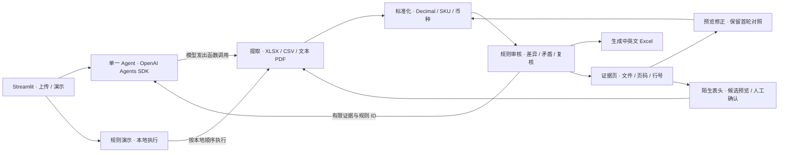

# 贸审通 TradeCheck Agent

面向中小外贸企业的跨境贸易单证审核工作台。上传采购订单、商业发票和装箱单后，可逐条核对异常、查看原始证据、修正会话内预览并导出中英文 Excel 报告。

## 本地运行

在项目根目录使用 Python 3.12。已在 Windows Python 3.12.14 上验证。

```powershell
python -m venv .venv
.\.venv\Scripts\python.exe -m pip install -r requirements.txt
.\.venv\Scripts\python.exe -m streamlit run app.py --server.address 127.0.0.1
```

打开 `http://127.0.0.1:8501`，选择案例并点击 **一键加载演示案例**。未配置 API Key 时可直接运行规则演示。

启用 AI 模式时，在服务端环境变量或本地 `.streamlit/secrets.toml` 的顶层配置 `DEEPSEEK_API_KEY`，默认使用 `deepseek-flash`。可通过 `DEEPSEEK_MODEL` 覆盖模型。只配置 `OPENAI_API_KEY` 时使用 OpenAI，可通过 `TRADECHECK_MODEL` 选择模型。两种密钥都存在时优先 DeepSeek。环境变量示例见 [.env.example](.env.example)。 [DeepSeek Responses API](https://api-docs.deepseek.com/guides/responses_api/)

## 演示

| 案例 | 输入 | 预期 |
|---|---|---|
| A | 正常交易，包含 XLSX、CSV、文本 PDF | 0 项异常、0 项待复核 |
| B | 发票 90 件、21 USD；订单 100 件、20 USD；装箱 100 件，毛重 110 kg、净重 120 kg | 3 项业务差异、1 项逻辑矛盾。发票行金额 1890 USD 正确 |
| C | 行换序、重复 SKU、数值格式差异、重量缺值、装箱单引用其他订单 | 1 项业务差异、2 项待复核 |
| D | 商业发票使用陌生列名，数量列为 Billed Units | 确认四个字段后，检出两项跨单证数量差异 |
| E | 文本 PDF 装箱单没有表格边框 | 对照候选行确认表头后，检出一项数量差异和一项重量矛盾 |

上传一次审核对应一笔交易，每种单证一份。XLSX / CSV 支持横向商品表，也支持商品表上方的两列表头字段。PDF 支持有表格边框的商品表和带竖线分隔的文本表，以及 `PO Number: …` 等键值标题。若表格结构未被识别，系统会提示人工复核。模板和列名可参考 [案例 B](data/demo/B) 及 [字段别名](core/parser.py)。

### 陌生表头确认

1. 完成首轮审核后，展开「确认陌生表头或无边框 PDF」，选中单证并点击「查看原始表头」。
2. 对照表头位置、原列号和样例值。可手动指定字段。有服务器模型凭据时，也可授权模型根据原始表头和样例类型摘要给出候选建议。原文件、原始样例值和文件名留在应用服务器。
3. 检查候选字段，点击「确认表头并重新审核」。系统从原文件提取确认的列并运行规则。结果展示首轮和复审的核验变化。Excel 新增「表头确认记录」页。

无边框 PDF 预览只适用于文字层可读取、列较整齐并且左对齐的候选表格。系统按页确认，用户需对照预览中的行数与原件。每个工作表或 PDF 页面一次确认一张商品表。原件保留在会话中。

## 系统架构



AI 模式由模型发出四个函数调用，应用按执行事件记录工具名、顺序、状态、耗时和摘要。AI 的解读与规则结果分开展示。解析、匹配和数值计算均在服务端运行。模型接收规则 ID、有限数值和用户填写的指令，上传文件、文件名、企业名称、订单编号和 SKU 留在应用服务端。上传数据和预览修改保存在当前会话。

## 审核口径

- 先用订单编号关联文档。装箱单声明发票编号时同时核对该编号。仅在关联成功后使用唯一 SKU 比较对应行。重复、缺失或无法关联的 SKU 进入人工复核。
- 数量与单价需要兼容的计量单位。单价比较还需要币种相同。行金额按明确币种的小数位数和半入舍入规则核对。单价保留原有精度，币种不换算。
- 单个逗号后有三位数字的输入会进入人工复核。支持显式小数及分组格式，包括 `1,200.50`、`1.200,50` 和 `1 200`。
- 发票总额与行金额合计出现差额时，提示人工核对运费、税费或折扣。装箱重量按 kg 检查。
- 系统仅检查单证内容一致性。扫描件 OCR、任意 PDF 布局、复杂分批合并及海关法律合规保证超出当前范围。

## 项目文件

- `app.py` 提供界面、会话状态、报告选择与复核交互。
- `agent/` 提供单 Agent、工具和安全的服务端调用。
- `core/` 提供解析、字段模型、标准化、审核和报告。
- `data/demo/` 与 `data/benchmark/` 包含演示和基准单证，案例目录内的 `truth.json` 保存标准答案。
- [部署手册](DEPLOYMENT.md) 记录发布操作和验收项。[评估记录](EVALUATION.md) 解释指标口径。[竞赛说明](COMPETITION.md) 包含创新点、开发计划、三分钟演示和 PPT 提纲。
